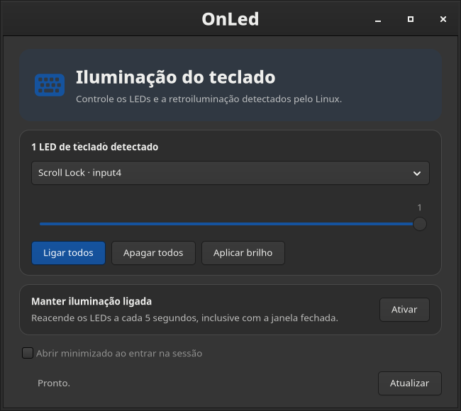
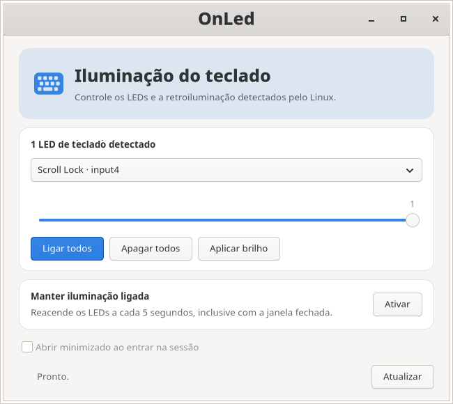

# OnLed 1.1.0

Controle os LEDs do teclado no Linux, incluindo teclados que acendem por
Scroll Lock. O OnLed permite definir o brilho dos dispositivos detectados e
manter a iluminação ligada em segundo plano.




## Instalação

Fedora 45:

```sh
sudo dnf install ./onled-1.1.0-1.fc45.noarch.rpm
```

Debian e Ubuntu com GTK 4 e GJS disponíveis:

```sh
sudo apt install ./onled_1.1.0_all.deb
```

Abra **OnLed** no menu. A instalação pede autorização administrativa. Por
padrão, numa sessão local ativa, o Polkit permite que o OnLed chame apenas seu
helper de controle do teclado. O botão **Ativar** inicia a iluminação
automática e a mantém habilitada após reiniciar o sistema.

### AppImage

O AppImage x86_64 usa GJS, GTK 4 e Python 3 instalados pelo sistema. Ele
detecta LEDs sem o pacote nativo. Para mudar o brilho ou controlar o serviço,
instale o DEB ou RPM para registrar o helper e a política do Polkit no sistema.

```sh
chmod +x OnLed-1.1.0-x86_64.AppImage
./OnLed-1.1.0-x86_64.AppImage --appimage-extract-and-run
```

O OnLed controla a luminosidade exposta pelo kernel. Cores e efeitos
proprietários, quando dependem de um controlador separado, exigem suporte
específico ao teclado.

## Empacotamento

Em uma máquina com `dpkg-deb` e `rpmbuild`, execute
`bash packaging/build.sh ./dist` com `TMPDIR` num sistema de arquivos Linux.
Para incluir o AppImage, passe também o caminho do runtime x86_64 oficial e a
pasta com seus avisos de terceiros. O build do AppImage usa `mksquashfs`.

## Licença

OnLed é distribuído sob **GPL-3.0-only**. Consulte [LICENSE](LICENSE).
O runtime do AppImage tem avisos próprios e fontes correspondentes separados.
